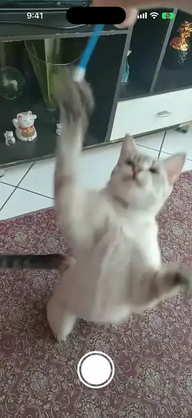

<h1></h1>

A camera for the iOS Simulator. Your app's camera code runs unmodified, through Apple's own AVFoundation.

<p align="center"></p>

```sh
npx stuntcam up
```

It arms the simulator and returns. Then run your app as usual. `npx stuntcam down` turns it off.

Needs an Apple silicon Mac and Xcode 27. Works with AVFoundation, VisionCamera 5, expo-camera 58 and Flutter
`camera` / `mobile_scanner`, on iOS 17.5 to 27.2. No code changes.

## What you get

- **Live preview** from the back wide, ultra-wide, telephoto and front cameras
- **Photos** in JPEG and HEIC, with EXIF
- **Video recording with audio**, 1080p and 4K (the audio is a generated tone)
- **QR and EAN-13 scanning** through AVFoundation and Vision
- **Your Mac's webcam** as the camera, live
- **Your own image or video** as the camera, or the built-in test scene
- **QR codes from text**, generated for you
- **Live switching**: change the picture while your app runs, no relaunch

## Usage

| To | Run |
|---|---|
| Xcode | `npx stuntcam up`, then ⌘R |
| React Native / Expo | `npx stuntcam up`, then `npx expo run:ios` |
| Flutter | `npx stuntcam up`, then `flutter run` |
| UI tests | `npx stuntcam exec -- xcodebuild test …` |
| Your own picture | `npx stuntcam source image:/path/photo.png` (or `video:`) |
| A QR code | `npx stuntcam source qr:'https://example.com/pay?id=42'` |
| Your Mac's camera | `npx stuntcam source webcam` |
| Camera not showing? | `npx stuntcam doctor` |

All commands: [cli/README.md](cli/README.md). Problems: [docs/TROUBLESHOOTING.md](docs/TROUBLESHOOTING.md).
Upgrading from 1.1.0: [docs/UPGRADING.md](docs/UPGRADING.md).

## AI agents

Coding agents can run stuntcam on their own. The stuntcam skill tells them how: allow the camera up front, script
what it sees with `source qr:` or `image:`, and check `status --json` and `trace`.

| Agent | Install |
|---|---|
| Claude Code | `/plugin install stuntcam --marketplace avinav-b/stuntcam` |
| Codex, Cursor and others | `npx skills add avinav-b/stuntcam` |
| By hand | Copy [SKILL.md](packaging/agent-skill/skills/stuntcam/SKILL.md) to your agent's skills folder as `stuntcam/SKILL.md` |

## Limits

- 4K60 records at about 16–32 fps
- No 720p format; zoom isn't shown; flash never fires

## License

Apache-2.0
